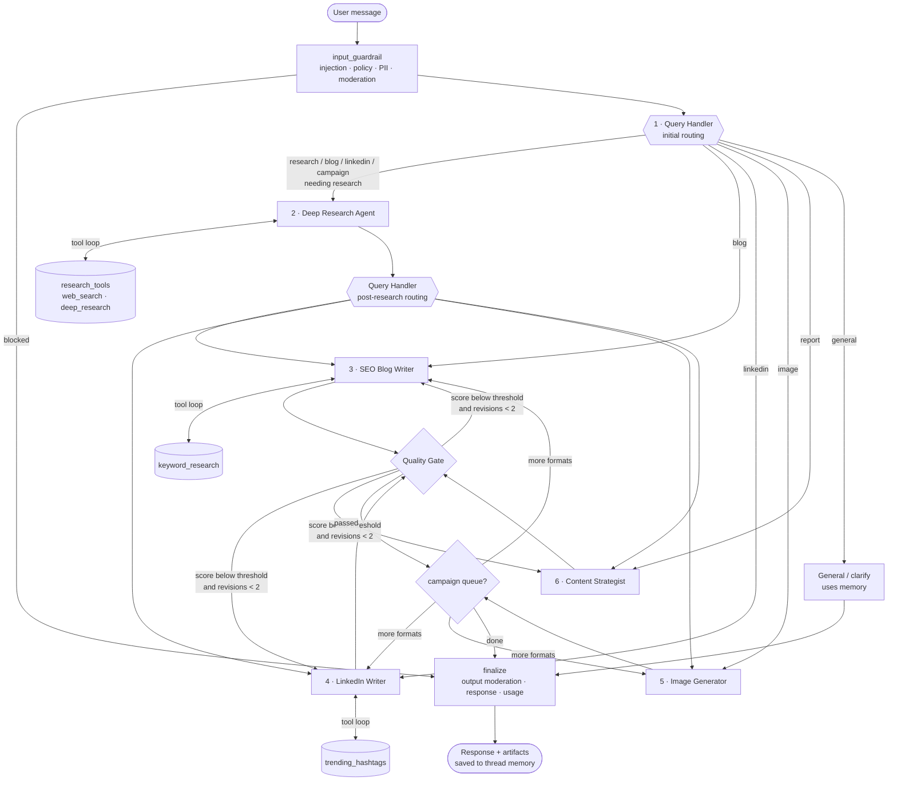

# agents.md — ContentBlitz (ContentAlchemy) Agent Reference

ContentBlitz is a **LangGraph multi-agent content marketing assistant** for small businesses and solo creators.
Six specialized agents produce **research reports, SEO blog posts, LinkedIn posts and marketing images**.
Every output passes through a **content enhancement (quality) pipeline**, and redundant providers keep the
system running when an API fails.

This file is the authoritative reference for the project and for each agent. It's written for graders,
contributors and AI coding agents. For setup, see `README.md` / `README.txt`. For deeper design notes, see `docs/`.

---

## 1. Project at a glance

| Item | Value |
|---|---|
| Capstone | Project 2 — ContentBlitz: Content Marketing Agent (Applied Agentic AI for SWEs) |
| Orchestration | LangGraph `StateGraph` (router + agent ↔ ToolNode loops + checkpointer) |
| Agents | Query Handler · Deep Research · SEO Blog Writer · LinkedIn Writer · Image Generator · Content Strategist |
| LLM | OpenAI `gpt-4o` (writing) / `gpt-4o-mini` (routing, scoring); fallback `gpt-4.1-mini`; Anthropic (`claude-sonnet-5-5` / `claude-haiku-5-5`) and Gemini (`gemini-pro-latest` / `gemini-3.8-flash`) switchable with `LLM_PROVIDER`; all three verified live end to end |
| Research | SerpAPI → Tavily → Perplexity Agent API (fallback chain, 30-min cache, stale-cache outage fallback) |
| Images | gpt-image-1 → gpt-image-1-mini → Gemini 2.5 Flash Image → Pillow branded placeholder |
| Memory | `InMemorySaver` (dev) / `SqliteSaver` (prod) keyed by `thread_id` |
| UI | Streamlit: Chat · Content Dashboard · Research · Images · Export · Settings |
| Tests | 227 offline tests (unit / integration / e2e UI + notebook) at ~98% coverage, plus `pytest -m live`; GitHub Actions CI on every push (Python 3.11–3.14 + Docker image build) |

### Repository map

```
contentalchemy/
├── agents.md                 ← this file
├── README.md / README.txt    ← setup, usage, troubleshooting, cost tips
├── langgraph.json            ← `langgraph dev` / LangGraph Studio entry point
├── config/                   ← services.yaml (providers, chains, pricing) + development/production.yaml
├── src/
│   ├── agents/               ← the six agents + shared AgentDeps / tool-loop helpers
│   ├── core/                 ← config, prompts, templates, router (edges), workflow (ContentBlitz facade)
│   ├── integrations/         ← LLM service, SerpAPI/Tavily/Perplexity clients + SearchChain, image clients
│   ├── utils/                ← guardrails, content optimization, quality validation, export, cache, observability
│   ├── workflow/             ← state_management (state + models), langgraph_workflow (graph assembly)
│   └── web_app/              ← streamlit_app.py + components/ + static/
├── tests/                    ← unit/, integration/, e2e/ (+ conftest.py fakes)
├── notebooks/                ← contentblitz_walkthrough.ipynb (10-step teaching walkthrough)
├── scripts/                  ← benchmark_services.py
└── docs/                     ← architecture, API, deployment, technical design, service comparison
```

---

## 2. How the agents work together



**Inter-agent communication** goes entirely through the shared `ContentState` (a `TypedDict`). No agent
calls another agent directly. Each agent reads what it needs (for example `research`, `brand`, `request`) and
writes back a partial update (`blog`, `sources`, `quality_target`, ...). The router functions in
`src/core/router.py` read state to decide the next node. That keeps each agent isolated and testable,
while the graph handles the coordination.

**Two routing decisions** (as the spec requires):
1. *Initial routing*: what does the user want? (`query_handler`)
2. *Post-research routing*: now that research is done, should the next step be a blog, a LinkedIn post, an image,
   or just a research report? (`post_research_router`)

**Content series / campaigns**: "create a full campaign about X" fills a `pending_formats` queue
(for example `["blog", "linkedin", "image"]`). After each artifact finishes, the graph moves on to the next format.
Every format reuses the same research and brand voice, so the campaign stays consistent.

---

## 3. Shared state (`src/workflow/state_management.py`)

| Field | Type | Written by | Purpose |
|---|---|---|---|
| `messages` | `add_messages` list | input_guardrail, finalize | User-visible conversation, which is the memory the general handler and router use |
| `agent_scratch` | `add_messages` list | research/blog/LinkedIn agents, ToolNodes | Working memory for tool loops, cleared after each agent so tool chatter never reaches the conversation |
| `user_input` | str | input_guardrail | Sanitized latest message (PII redacted) |
| `route` / `request` | str / `ContentRequest` | query_handler | Intent, topic, keyword, template, refine target, clarifying question |
| `next_after_research` | str | post_research_router | blog / linkedin / image / report |
| `pending_formats` | list[str] | query_handler, quality_gate, image_generator | Campaign queue |
| `brand` | `BrandProfile` | UI / input_guardrail | Brand voice used by every writer and by the quality checks |
| `research`, `report`, `blog`, `linkedin`, `image`, `images` | artifact dicts | agents | Outputs. **Each carries a `provenance` block** |
| `sources` | list (reducer `merge_sources`) | research + writers | **Thread-wide source registry**: deduplicated by URL; stable `[n]` ids across turns; `used_in` tracking |
| `quality` | dict[kind → `QualityReport`] | quality_gate | Scores, metrics, suggestions |
| `revision_count`, `revision_feedback`, `quality_target` | | quality_gate / writers | Revision loop control |
| `warnings`, `final_response`, `usage`, `outputs_this_turn` | | various / finalize | Per-turn reporting |

### Provenance and source attribution (applies to every output)

Each artifact has a `Provenance` block containing:
- `sources`: each with id, title, URL, publisher, snippet, retrieved_at, provider, and used_in.
- `generated_by`: the provider and model, for example `openai:gpt-4o`.
- `image_model`: images only.
- `grounding`: one of `live_research`, `cached_research`, or `model_knowledge_only`.
- `revision_count`.
- `notes`: fallbacks used, links removed, and so on.

`Provenance.to_markdown()` renders the **Sources & Provenance** section that appears in every output and export.

- **Research / reports**: inline `[n]` citations plus a Sources section.
- **Blog**: every statistic and claim gets an inline `[n]` citation. Statistics without a citation are flagged and lower the score.
- **LinkedIn**: the post body has no links (links hurt reach). Sources go in a suggested **first comment**.
- **Images**: provenance records the original and enhanced prompts, which model actually produced the image, and any fallbacks.
- **General answers and fallbacks**: labeled *"Based on AI model knowledge — not verified against live sources."*
- **Guardrail**: any URL in any output that isn't in the source registry is removed. Models only ever see numbered
  sources **without URLs**, so they have nothing to copy or alter.

---

## 4. The six agents

Every agent lives in `src/agents/<name>.py` and exposes a **factory** `make_<agent>(deps) -> node(state) -> dict`.
All external services come in through `AgentDeps` (`src/agents/__init__.py`):

```python
@dataclass
class AgentDeps:
    config: AppConfig          # YAML + env settings
    llm: LLMService            # tiered LLM access with fallbacks (smart / fast)
    search: SearchChain        # SerpAPI → Tavily → Perplexity, cached
    images: ImageChain         # gpt-image-1 → gpt-image-1-mini → Gemini 2.5 Flash Image → placeholder
    validator: QualityValidator
    tracker: CostTracker       # tokens / searches / images → USD
    moderator: ModerationClient | None
    turn: TurnBudget           # per-request counters (deep_research cap)
```

`AgentDeps.from_config(config)` wires up the real clients. Tests use `tests/conftest.py::build_fake_deps(...)`,
which supplies a scripted fake LLM and fake providers. **This is what makes each agent testable on its own.**

### 4.1 Query Handler (`src/agents/query_handler.py`)

| | |
|---|---|
| **Purpose** | Understand the request and route it: research, blog, linkedin, image, report, campaign, or general. Also handles post-research routing, and the general/clarify path, which uses memory |
| **Nodes** | `query_handler`, `post_research_router`, `general` |
| **Reads** | `user_input`, recent `messages`, existing artifacts (`research`, `blog`, `linkedin`, `image`) |
| **Writes** | `request` (`ContentRequest`), `route`, `pending_formats`, `next_after_research`, `final_response` (general) |
| **LLM** | `fast` tier, structured output `ContentRequest` (prompt `QUERY_HANDLER`, with few-shot examples) |
| **Context engineering** | The last 6 messages plus a summary of existing artifacts, so follow-ups like *"now make it a LinkedIn post"* and *"make the blog more casual"* resolve correctly |
| **Deterministic rules** (`finalize_request`) | "What should I write/post about?" without a named format becomes a research request with the `trend report` template, and report templates always route to the Content Strategist. Skip research if matching research already exists (topic overlap) or when refining a draft. Validate campaign formats. Default the keyword. "Refine" only applies if the draft exists |
| **Fallbacks** | If the LLM fails, `heuristic_request` (keyword rules) takes over. If post-research routing fails, it defaults to `report`. If the general handler's LLM is down, it returns a friendly message |
| **Guardrails** | Ambiguous requests get a clarifying question. General answers are labeled "model knowledge" |
| **Test in isolation** | `pytest tests/unit/test_agent_query_handler.py` |

```python
from src.agents.query_handler import make_query_handler
node = make_query_handler(deps)
node({"user_input": "Write an SEO blog about email marketing for bakeries"})
# → {"route": "research", "request": {"intent": "blog", "topic": ..., "target_keyword": ...}, ...}
```

### 4.2 Deep Research Agent (`src/agents/research_agent.py`)

| | |
|---|---|
| **Purpose** | Generate several strategic search queries, gather multi-source evidence, and synthesize findings with citations |
| **Nodes** | `research_agent` ⇄ `research_tools` (ToolNode on `agent_scratch`) |
| **Tools** | `web_search(query)`: cheap, called several times. `deep_research(question)`: expensive Perplexity/Tavily-advanced synthesis, **capped at 1 per request** (`TurnBudget`). `trending_topics(niche)`: **trend radar**, Google Trends related queries via SerpAPI (rising with % growth, plus top), filtered for relevance to the niche |
| **Trend radar** | Runs automatically for trend / "what should I write about" requests (`wants_trends`). The Google Trends explore page is registered as a real source, so every growth figure carries a valid `[n]`. `render_trend_radar` adds a **Trend Radar** table to the research brief, and the Content Strategist keeps it in the report even if the model drops it. The top rising searches go into the Query Handler's context, so "write about the fastest-rising one" resolves |
| **Reads / writes** | Reads `request`, `sources`. Writes `research` (`ResearchReport`) and `sources` (registry with stable ids) |
| **LLM** | `fast` model for the tool loop (prompt `RESEARCH_AGENT`). `smart` model for synthesis (structured `ResearchSynthesis`, prompt `RESEARCH_SYNTHESIS`) |
| **Citation integrity** | Off-topic results (no meaningful word shared with the topic) are dropped first (`drop_off_topic`, never all of them). Retrieved sources go into the registry, which assigns `[n]` ids. The model sees a numbered list without URLs. Finding ids not in the list (for example `[99]`) are dropped |
| **Fallbacks** | If the model skips tools, the agent runs 3 strategic fallback queries itself. If a provider fails, the next provider is tried. If every provider fails, it uses stale cache. If nothing works, it labels the report `model_knowledge_only` and omits statistics. If synthesis fails, it builds findings from source snippets |
| **Cost control** | 30-min TTL cache, max tool iterations (6), deep-research cap, cheap model for the loop |
| **Test in isolation** | `pytest tests/unit/test_agent_research.py` |

### 4.3 SEO Blog Writer (`src/agents/blog_writer.py`)

| | |
|---|---|
| **Purpose** | Long-form SEO content: one H1, H2/H3 structure, 1–2% keyword density, 150–160 character meta description, slug, FAQ, CTA, internal-link ideas |
| **Nodes** | `blog_writer` ⇄ `blog_tools` (`keyword_research(seed)`: SerpAPI related searches + People-also-ask) |
| **Reads / writes** | Reads `research`, `brand`, `request`, `sources`, and the previous `blog` when revising. Writes `blog` (`BlogPost`), `quality_target="blog"` |
| **LLM** | `smart` tier, structured `BlogDraft` (prompt `BLOG_WRITER`: Moz on-page SEO, Google helpful-content/E-E-A-T, brand block, grounding rules) |
| **Templates** | how-to · listicle · comparison · thought leadership (`src/core/templates.py`; the user can name one, otherwise it's auto-suggested) |
| **Long-form expansion** | gpt-4o writes about 700 words per reply however much it is asked for, so a draft under 1,200 words is grown **one `##` section at a time** (`expand_short_draft`, prompt `BLOG_EXPANDER`): body sections get parallel requests for ~250 more words in plain language, keeping headings and `[n]` citations; the FAQ and conclusion are left alone. A section is replaced only if its heading is kept and it got longer. Measured live: 657 → 1,304 and 666 → 1,360 words, scores 81 and 91 |
| **Deterministic post-processing** | `fit_meta_description`. `slugify(keyword)`. Exactly one H1 with an author/reviewer byline (E-E-A-T). Extra H1s demoted. `scrub_body` drops any model-written Sources section, invented URLs and invalid `[n]`. Internal-link fallback from H2s. Provenance appended |
| **Revision mode** | Uses quality-gate feedback or user refine instructions. Skips the keyword tools and includes the whole previous draft. A user refine also gets the draft's open quality suggestions and keeps the post's target keyword (`finalize_request`); `BLOG_REVISION_KEEP` asks the model to keep the H1, keyword placement, FAQ, conclusion and citations, and `keep_faq_section` restores the FAQ if a rewrite drops it. One author byline only |
| **Fallbacks** | If structured output fails, it falls back to plain-text Markdown and derives the metadata. If the LLM is down, it sends a warning and the campaign continues |
| **Test in isolation** | `pytest tests/unit/test_agent_writers.py -k blog` |

### 4.4 LinkedIn Post Writer (`src/agents/linkedin_writer.py`)

| | |
|---|---|
| **Purpose** | 1300–1600 character post: hook → story → insights → CTA, 8–12 hashtags, mobile-friendly line breaks |
| **Nodes** | `linkedin_writer` ⇄ `linkedin_tools` (`trending_hashtags(topic)`: trend search plus hashtag candidates) |
| **Reads / writes** | Reads `research`, `brand`, `blog` (for voice consistency in campaigns). Writes `linkedin` (`LinkedInPost`), `quality_target="linkedin"` |
| **LLM** | `smart` tier, structured `LinkedInDraft` (prompt `LINKEDIN_WRITER`) |
| **Templates** | insights · story · tips · announcement |
| **Hook variants** | The model returns 4 alternative hooks (story · hot take · how-to hack · data point). `rank_hooks` scores each with the quality gate's `score_hook` rules (length, clichés, stock openers, exclamation marks, and **grounding**: a number or "doubled/tripled" result that isn't in the research costs 30 points, so an invented success story never leads the post); the best leads the post (ties keep the drafted hook) and all are stored in `hook_options`. `swap_hook` / `ContentBlitz.apply_hook` swap one in from the Dashboard and re-score |
| **Deterministic formatting** | `strip_links` (links move to the first comment). Remove `[n]`. `format_linkedin`: normalize/dedupe CamelCase hashtags, cap at 12, top up from trend candidates, split long paragraphs, trim to 1600 characters at a sentence boundary |
| **Attribution** | `first_comment` = "📚 Sources for this post:" plus the top research sources with URLs |
| **Test in isolation** | `pytest tests/unit/test_agent_writers.py -k linkedin` |

### 4.5 Image Generator (`src/agents/image_generator.py`)

| | |
|---|---|
| **Purpose** | Marketing visuals with prompt optimization |
| **Pipeline** | (1) Art-director **prompt enhancement**: subject, composition with negative space, lighting, lens, mood, brand palette and visual style, no text or logos, plus accessible alt text (`fast` model, `IMAGE_PROMPT`). A fixed `NO_TEXT_SUFFIX` is appended to every prompt sent to a provider, because image models letter signs and packaging unless told plainly not to. (2) **Moderation** of the enhanced prompt. (3) **Fallback chain** gpt-image-1 → gpt-image-1-mini → Gemini 2.5 Flash Image → Pillow branded placeholder. (4) **Pillow validation** (decodable, minimum 256 px), normalized to PNG. (5) Saved to `outputs/images/<timestamp>-<slug>.png` with a `.json` metadata file |
| **Reads / writes** | Reads `request.image_prompt`, `brand`, `blog`/`linkedin` (campaign context). Writes `image`, `images` (gallery), `pending_formats` |
| **Fallbacks** | If enhancement fails, a deterministic template prompt is used. Each provider failure is recorded in `attempts` and in provenance notes. The placeholder never fails |
| **Note** | gpt-image-1 needs a verified OpenAI organization. Without one, gpt-image-1-mini becomes the default automatically. DALL-E 2/3 are retired by OpenAI. Quality is pinned to `medium` (the API default `high` costs ~4×) |
| **Test in isolation** | `pytest tests/unit/test_agent_writers.py -k image` and `tests/unit/test_image_clients.py` |

### 4.6 Content Strategist (`src/agents/content_strategist.py`)

| | |
|---|---|
| **Purpose** | Format research into a readable report when no specific format was requested |
| **Templates** | trend report · market analysis · competitive analysis |
| **Reads / writes** | Reads `research`, `brand`, `sources`. Writes `report` (`StrategyReport`), `quality_target="report"` |
| **LLM** | `smart` tier, Markdown output (prompt `CONTENT_STRATEGIST`) |
| **Guardrails** | `scrub_body` (no invented URLs, no invalid ids, no model-written Sources). Adds a title if one is missing. Provenance comes from the registry |
| **Fallbacks** | If the LLM is down, it returns the research brief itself, with a warning |
| **Test in isolation** | `pytest tests/unit/test_agent_writers.py -k strategist` |

---

## 5. Content enhancement pipeline (quality gate)

`quality_gate` (in `src/workflow/langgraph_workflow.py`) scores every blog, LinkedIn post and report using
`QualityValidator` (`src/utils/quality_validation.py`). **All scores are computed in Python**; the
LLM critique (`QUALITY_CRITIC`) only adds advisory feedback, as a guard against scoring drift.

| Content | Weighted categories (0–100 each) |
|---|---|
| Blog | SEO 30% (density 1–2%, keyword in H1 and first 100 words, meta 150–160 characters, title ≤ 60 characters with the keyword near the front, keyword in the slug) · Structure 20% (one H1, ≥ 3 H2, no skipped levels, FAQ, CTA) · Readability 15% (Flesch vs brand target) · Citations 15% (uncited statistics, invalid ids) · Brand voice 10% · Length 10% |
| LinkedIn | Length 25% (1300–1600) · Hashtags 15% (8–12) · Hook 15% (≤ 210 characters, no clichés or stock openers, no exclamation marks) · Formatting 20% (paragraphs, no links, readability) · CTA 10% · Brand voice 15% |
| Report | Structure 35% · Citations 35% · Readability 15% · Brand voice 15% |

If `overall < pass_threshold` (70 in dev, 75 in prod), the gate sends up to 8 suggestions back to the same
writer, for at most `max_revisions` (2) rewrites, and only while the request is under its budget. Otherwise it
records a warning and moves on. Users can also edit content in the **Content Dashboard** and re-score it.

**Brand voice consistency** works in four ways:
- One `BrandProfile` (tone, audience, values, banned words, signature phrases, CTA, palette, visual style, location, **writing persona**, **emoji level**, **sentence length**) is injected into every writer prompt.
- The same profile is checked by rules (banned words, required phrases, reading ease, exclamation marks, emoji use vs the brand's level, average sentence length within ±50% of the brand's).
- The campaign writers see each other's outputs.
- *Learn my brand voice* infers a profile from sample text you paste in: the LLM picks tone, audience and persona; sentence length, emoji level and reading ease are measured in Python.

---

## 6. Guardrails

| Layer | Guardrail | Where |
|---|---|---|
| Input | Empty / too-long (4000 characters) rejection | `guardrails.check_input` |
| Input | Prompt-injection regex screen (ignore previous instructions, reveal system prompt, DAN, role tags…) | `INJECTION_PATTERNS` |
| Input | Policy screen: fake reviews/testimonials, impersonation, competitor defamation | `POLICY_PATTERNS` |
| Input | PII redaction (email, phone, SSN, Luhn-valid cards) **before** any LLM call or memory write | `redact_pii` |
| Input | OpenAI moderation (fails open with a warning) | `ModerationClient` |
| Execution | Max tool iterations per loop (6) · deep_research ≤ 1 · revisions ≤ 2 · LangGraph `recursion_limit` (40) | config `guardrails` |
| Execution | Per-request cost budget (USD) stops revisions and remaining campaign formats | `CostTracker.over_budget` |
| Execution | Timeouts + exponential-backoff retries (tenacity) + provider fallbacks | `integrations/__init__.py` |
| Output | Citation integrity: only registry URLs survive; merged citations (`[7, 8]`, `[2-4]`) are split and each id checked; invalid `[n]` removed | `enforce_citation_integrity`, `normalize_citations`, `scrub_body` |
| Output | No template leftovers: `[Your City]`-style placeholders become the brand location, or "your area" when none is set | `fill_location_placeholders` |
| Output | LinkedIn: no links in body; hashtag/length limits enforced in code | `strip_links`, `format_linkedin` |
| Output | Moderation of generated text and image prompts; unsafe artifacts are withheld | `finalize`, image agent |
| Output | Grounding labels and AI-assisted-content disclosure in every export | `Provenance` |

---

## 7. Redundancy and performance

- **LLM**: smart/fast tiers. Fallback models via `LLMService.invoke`, plus bound fallbacks for tool loops. Provider switch with `LLM_PROVIDER`. Per-provider quirks live in config, not code: the `anthropic` block sets `temperature: null` (Claude Sonnet 5.5 / Haiku 5.5 reject sampling parameters) and `structured_output: json_schema` (forced tool calls are a 400 on Sonnet 5.5). `Secrets.format_warnings` flags a key pasted into the wrong slot.
- **Research**: `SearchChain` tries SerpAPI → Tavily → Perplexity, then stale cache, then an explicit offline outcome. Results are cached for 30 minutes.
- **Images**: `ImageChain` (4 levels across two providers, OpenAI and Google; the last one never fails).
- **Structured output**: native structured output first (function calling, or `json_schema` per provider), then JSON-mode parsing, then deterministic fallbacks.
- **Observability**: `CostTracker` (tokens, searches, images, cache hits, USD per request, shown in the UI), JSON logs in production, optional LangSmith tracing.

---

## 8. Running and testing each capability

```bash
# whole suite (offline, no keys needed)
pytest --cov=src

# one agent at a time
pytest tests/unit/test_agent_query_handler.py
pytest tests/unit/test_agent_research.py
pytest tests/unit/test_agent_writers.py -k blog        # or: linkedin | image | strategist

# the content pipeline / guardrails / fallbacks
pytest tests/unit/test_quality_validation.py tests/unit/test_content_optimization.py
pytest tests/unit/test_guardrails.py tests/unit/test_search_clients.py tests/unit/test_image_clients.py

# whole graph (every route, memory, revisions, budget, outages)
pytest tests/integration

# UI smoke tests (Streamlit AppTest) and real-API checks
pytest tests/e2e
pytest -m live          # requires keys in .env
```

Driving one agent by hand (notebook or REPL):

```python
from src.core.config import load_config
from src.agents import AgentDeps
from src.agents.research_agent import make_research_agent, make_research_tools

deps = AgentDeps.from_config(load_config())
tools = make_research_tools(deps)
print(tools[0].invoke({"query": "bakery email marketing statistics 2026"}))   # call a tool directly
```

---

## 9. Conventions for contributors and AI agents

- Prompts live only in `src/core/prompts.py`. Each starts with `ROLE: <name>`, which the test fakes use to dispatch replies.
- Agents never import SDKs directly. Go through `AgentDeps` (LLMService, SearchChain, ImageChain).
- Store artifacts in state as `model_dump()` dicts (checkpointer-safe), and rehydrate them with `Model.model_validate`.
- Every new output type **must** carry a `Provenance` and go through `scrub_body` or an equivalent guardrail.
- Add a unit test for each new agent behavior, and an integration test for each new route.
- Never commit `.env` or anything under `outputs/` or `.cache/`.
