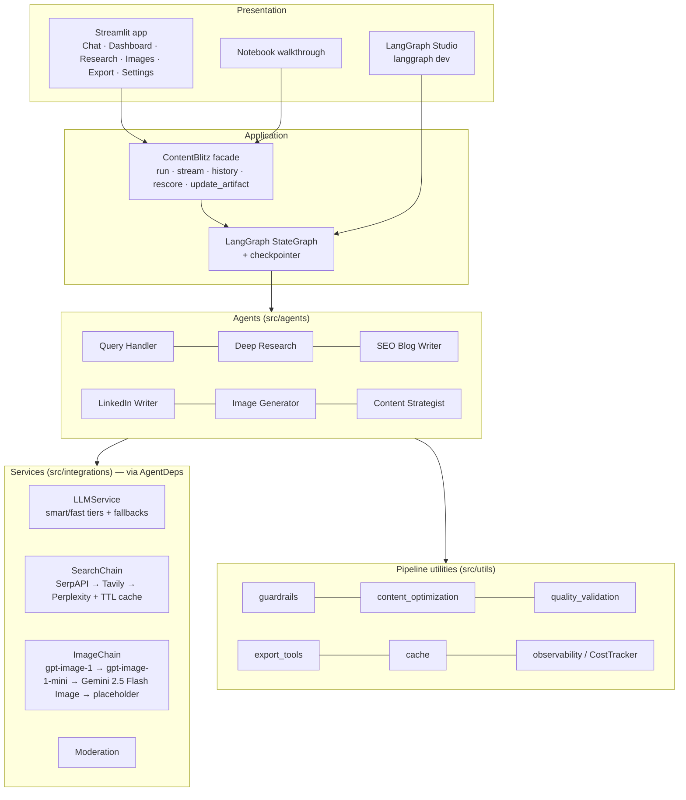
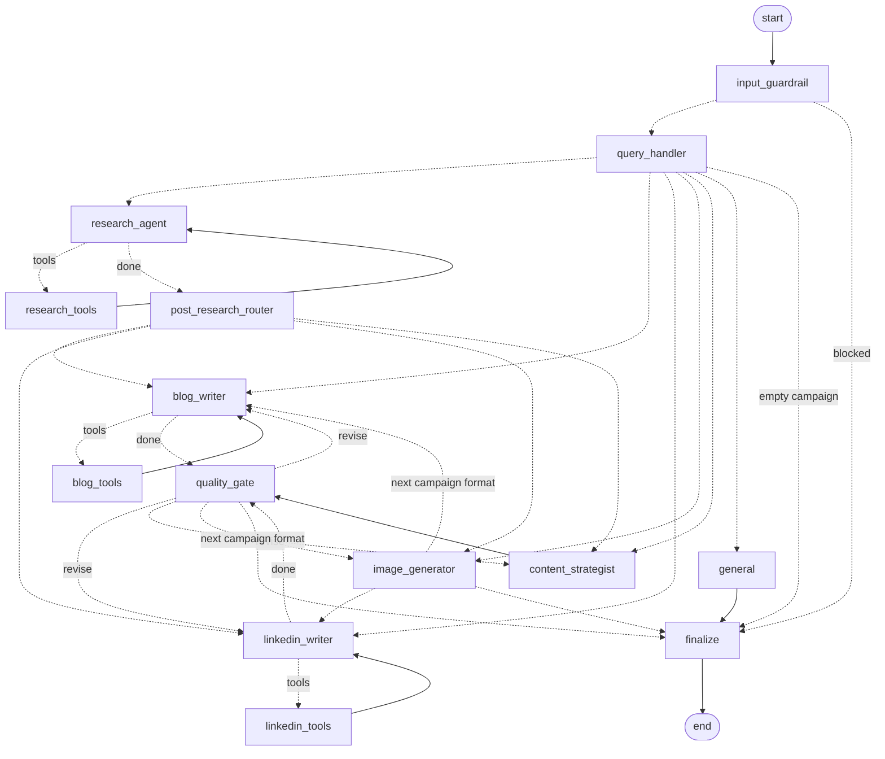
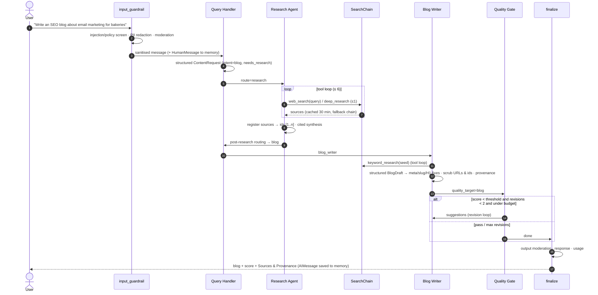
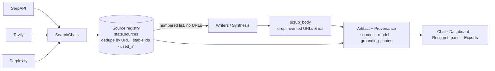

# Architecture

ContentBlitz is a single LangGraph `StateGraph` (14 nodes) built from six specialized agents, three
tool nodes, and three control nodes (input guardrail, quality gate, finalize). The UI, the notebook
and the tests all reach it through one facade, `ContentBlitz` (`src/core/workflow.py`).

## 1. Layered view



## 2. Graph (generated from the compiled graph)



Regenerate the graph at any time:

```python
from src.core.workflow import ContentBlitz
print(ContentBlitz().graph.get_graph().draw_mermaid())
```

## 3. Research → blog sequence



## 4. Data and provenance flow



## 5. Memory model

- `messages` (conversation) and every artifact are checkpointed per `thread_id`.
- `InMemorySaver` in development; `SqliteSaver` (`.cache/checkpoints.sqlite`) in production.
- Each Streamlit browser session gets its own thread id; "New conversation" starts a fresh thread.
- Tool-loop messages live in `agent_scratch`, which is cleared after each agent, so the memory holds only user
  turns and final assistant responses.
